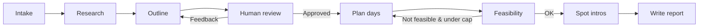

# travel_agent · Travel Itinerary Planning Agent

**English** | [简体中文](README.md)

A single LangGraph directed graph that runs the full pipeline from **natural-language travel request → structured day-by-day itinerary → Markdown report → (optional) Word export**, demonstrating four advanced features at once: **human-in-the-loop review, day subgraphs, a feasibility reflection loop, and Markdown→Word export**.



## Features

| Feature | Description |
|---|---|
| Human-in-the-loop review | `interrupt()` surfaces the outline; approve with Enter or type feedback to regenerate |
| Day subgraphs | "Sequence stops → add logistics" as a standalone StateGraph with isolated substate, invoked per day |
| Feasibility reflection loop | Structured check for overloads / budget breaches / time conflicts; replans with per-day fixes, capped by `MAX_ITER` |
| Markdown → Word | One-flag export via the bundled `md2docx.py` (`--docx`) |
| Live research (optional) | Concurrent TinyFish CLI lookups for attractions / weather / transport / food; auto-degrades when unavailable |
| Spot intros | Concurrent 200–500-character introductions per attraction after the plan is finalized (`--no-intro` to skip) |
| End-to-end resilience | Every structured LLM call has a fallback; `--no-web` runs fully offline on built-in stubs |

## Quick Start

### Requirements

- Python 3.10+
- An Anthropic-compatible API (official API or any Claude-compatible proxy)

### Install

```bash
git clone <your-repo-url>
cd travel_agent
pip install -r requirements.txt
```

### Configure

```bash
cp .env.example .env
```

Edit `.env` with your credentials (`.env` is gitignored and will never be committed):

| Variable | Required | Description |
|---|---|---|
| `ANTHROPIC_API_KEY` or `ANTHROPIC_AUTH_TOKEN` | Yes | API key / proxy token (either one) |
| `ANTHROPIC_BASE_URL` | Yes | `https://api.anthropic.com` or your proxy URL |
| `VERIFY_MODEL` | No | Override the default model (`claude-opus-4-8`) |

### Run

```bash
# 1) Safest first step: offline run (built-in stubs + auto-approve)
python agent.py -q "3 days in Beijing, history and food, budget 3000 CNY, for two" --no-web --auto-approve

# 2) Live search + human review (default): pauses at the outline;
#    press Enter to approve, or type feedback to regenerate
python agent.py -q "3 days in Chengdu, focused on food"

# 3) Interactive mode (multiple turns, independent threads)
python agent.py

# 4) Export Word after the run (calls md2docx.py in this directory)
python agent.py -q "2 days in Shanghai, family with kids" --docx --auto-approve

# 5) Skip spot intros for speed
python agent.py -q "2 days in Shanghai, family with kids" --no-intro --auto-approve
```

> Reports and Word files are written to `dist/` by default; pass an absolute path or a path with directories via `-o` to override.

### CLI Options

| Option | Description |
|---|---|
| `-q/--question` | Travel request; omit to enter interactive mode |
| `--no-web` | Disable live search, use built-in stubs |
| `--no-intro` | Skip spot introductions (faster) |
| `--docx` | Export the report to Word after the run |
| `--auto-approve` | Skip human review (for scripting / tests) |
| `-o/--out` | Output path (default `行程_目的地_N天.md` under `dist/`) |

## Project Structure

```
travel_agent/
├── agent.py           # Main graph: 8 nodes + HITL + reflection + streaming + CLI
├── day_subgraph.py    # Per-day planning subgraph (sequence stops → add logistics)
├── schemas.py         # 7 Pydantic data contracts
├── llm.py             # get_llm() / text_of() / _structured() (structured fallbacks)
├── tools.py           # TinyFish search wrapper + offline stubs + degradation
├── report.py          # DayPlan[] → Markdown (overview table / mermaid / appendix)
├── md2docx.py         # Markdown → Word converter (used by --docx)
├── test_agent.py      # 25 offline unit tests (no network, no real model calls)
├── .env.example       # Environment variable template
├── requirements.txt
└── README.md
```

## Tests

```bash
pip install pytest
python -m pytest test_agent.py -q
```

Fully offline: monkeypatching isolates the network and real model calls; coverage includes HITL resume, reflection convergence / capping, report rendering, and export.

## What Each File Teaches

- **llm.py**: Getting an LLM reliably in a messy real-world setup—disable thinking, generous `max_tokens`, `text_of()` for list content, `_structured()` returning a fallback on failure so the graph never dies.
- **schemas.py**: Pydantic data contracts for every step; container models work around `with_structured_output` not accepting `list[X]`.
- **tools.py**: Safely wrapping an external CLI—Windows `cmd /c`, `raw_decode` for the first JSON object, graceful degradation, offline stubs.
- **report.py**: Deterministically rendering structured results into Markdown with tables and mermaid (pure functions, fully unit-testable).
- **day_subgraph.py**: Turning a multi-step flow into a subgraph reused as a component by the main graph, with isolated substate.
- **agent.py**: LangGraph in one place—`StateGraph` + `add_messages`, `MemorySaver` for cross-turn memory, `interrupt`/`Command` HITL, conditional-edge reflection loop, `stream_mode="updates"` progress display.

## License

[Apache License 2.0](LICENSE)
